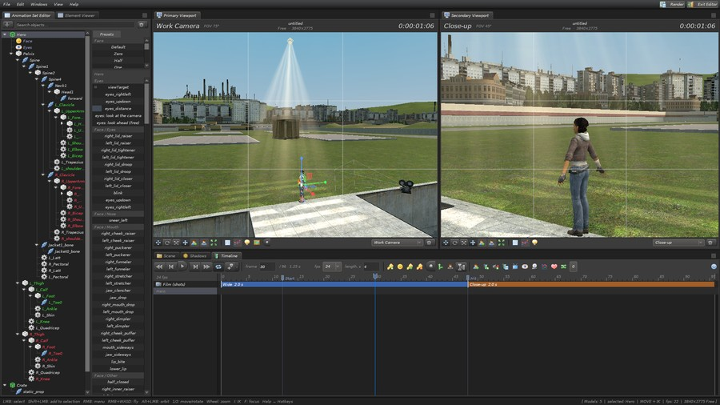

<h1 align="center">GM:FM — Garry's Mod Filmmaker</h1>

Scenes, animation and film inside Garry's Mod, close to a full port of Source Filmmaker. Called SPeditor until b0.1. 
Сцены, анимация и кино прямо в Garry's Mod — почти полный порт Source Filmmaker. До b0.1 назывался SPeditor.

<a href="https://steamcommunity.com/sharedfiles/filedetails/?id=3817852435"><b>Steam Workshop</b></a> ·
<a href="https://github.com/DikiyChuvak/GMFM/issues">Issues</a> ·
<a href="LICENSE">MIT</a>

## English

*The whole source code of GM:FM is open under the MIT license. Fork it, or dig into it if you
are an enthusiast. Changes from other developers may get into the Workshop version (always
credited) — message me on Steam first so I can look at what you have changed. The Simplified
Chinese translation is by [fugui9527121](https://github.com/fugui9527121) — thank you!*

This repository is the **full source code** of GM:FM b0.2.4 — the addon as it is on the
[Steam Workshop](https://steamcommunity.com/sharedfiles/filedetails/?id=3817852435), its
gamemode, shaders and tools. How to use the editor is explained inside the game: **Help → How
to use** (illustrated guides with live demonstrations).

### Run it from the source

1. Unsubscribe from GM:FM on the Workshop (two copies of the addon would clash).
2. Clone or unpack this repository into `garrysmod/addons/speditor` — the folder **must** be
   called `speditor` (the shader folder and the theme folder are looked for there).
3. Start Garry's Mod. Sandbox: C menu → GM:FM, or `gmfm_toggle`. The gamemode: Start New Game
   → gamemode **GM:FM**.

Lua autorefresh works for the files in `lua/`; a new file is picked up after
`lua/autorun/speditor_init.lua` is touched.

### What is where

| Path | What |
|---|---|
| `lua/autorun/speditor_init.lua` | loads everything: the lists `SHARED`, `SERVER_FILES`, `CLIENT_FILES` |
| `lua/speditor/sh_*.lua` | shared: settings (`sh_config`), languages (`sh_lang`), errors and reports, components |
| `lua/speditor/sv_*.lua` | server: objects, scenes, adopting map objects, PAC3, the Environment, the gamemode |
| `lua/speditor/cl_*.lua` | client: camera, gizmo, IK, rig, render (`cl_render`, `cl_export`, `cl_ssao`, `cl_postfx`), lights, effects, the whole interface (`cl_ui_*`), guides, self-test |
| `lua/speditor/saeditor/` | SAeditor — the animation component: tracks and keys, timeline, graph editor, sounds and lip sync, recorder, video |
| `lua/speditor/skins/` | Derma skins of the themes (GM:FM UI is `sfm.lua`) |
| `lua/entities/` | the editor's lights, cameras and effects |
| `gamemodes/gmfm/` | the GM:FM gamemode |
| `materials/`, `sound/`, `data_static/` | pictures, interface sounds, example scenes |
| `shaders_src/` → `shaders/fxc/` | HLSL sources of the SSAO, grain and colour correction shaders and their compiled `.vcs` (`shaders_src/build_vcs.py`; compile with `fxc /T ps_2_b`) |
| `tools/` | `build_gma.py` (the Workshop package), picture generators |

### Build the Workshop package

`python3 tools/build_gma.py out.gma` — writes the GMA itself (the game's Linux `gmad` refuses
`shaders/fxc/*.vcs`), skipping what `addon.json` → `ignore` lists.

### Contributing

Fork, change, open a pull request — and message me on Steam
([DikiyChuvak](https://steamcommunity.com/profiles/76561199542870153)) so I see it. Changes
that get into the Workshop version are credited by name. Bugs and ideas: the
[issues](https://github.com/DikiyChuvak/GMFM/issues) or the
[Workshop discussions](https://steamcommunity.com/workshop/filedetails/discussion/3817852435/567048683131023614/).

## Русский

*Весь исходный код GM:FM открыт под лицензией MIT. Делайте форки или копайтесь в нём, если
вы энтузиаст. Изменения других разработчиков могут попасть в версию мастерской (всегда с
упоминанием авторов) — напишите мне в личные сообщения Steam, чтобы я мог посмотреть, что вы
изменили. Перевод на упрощённый китайский — [fugui9527121](https://github.com/fugui9527121), спасибо!*

Здесь лежит **полный исходный код** GM:FM b0.2.4 — аддон в том виде, в каком он в
[мастерской Steam](https://steamcommunity.com/sharedfiles/filedetails/?id=3817852435), его
режим игры, шейдеры и инструменты. Как пользоваться редактором — внутри игры: **Help → How
to use** (руководства с картинками и живыми демонстрациями).

### Запуск из исходников

1. Отпишитесь от GM:FM в мастерской (две копии аддона будут мешать друг другу).
2. Склонируйте или распакуйте репозиторий в `garrysmod/addons/speditor` — папка **должна**
   называться `speditor` (там ищутся папки шейдеров и тем).
3. Запустите Garry's Mod. Sandbox: меню C → GM:FM или `gmfm_toggle`. Режим: «Новая игра» →
   режим **GM:FM**.

Автообновление Lua работает для файлов в `lua/`; новый файл подхватывается после того, как
изменён `lua/autorun/speditor_init.lua`.

Что где лежит — в таблице выше. Пакет для мастерской: `python3 tools/build_gma.py out.gma`.

### Участие

Форк, изменения, pull request — и напишите мне в Steam
([DikiyChuvak](https://steamcommunity.com/profiles/76561199542870153)), чтобы я увидел.
Изменения, попавшие в версию мастерской, подписываются именем автора. Ошибки и идеи —
[issues](https://github.com/DikiyChuvak/GMFM/issues) или
[обсуждения мастерской](https://steamcommunity.com/workshop/filedetails/discussion/3817852435/567048683131023614/).

## License / Лицензия

GM:FM's own code and content: [MIT](LICENSE). The bundled skins, sounds and Source Filmmaker
pictures of other authors keep their own terms: [THIRD_PARTY.md](THIRD_PARTY.md).

Собственный код и содержимое GM:FM — [MIT](LICENSE). Встроенные скины, звуки и картинки
Source Filmmaker других авторов остаются на своих условиях: [THIRD_PARTY.md](THIRD_PARTY.md).
